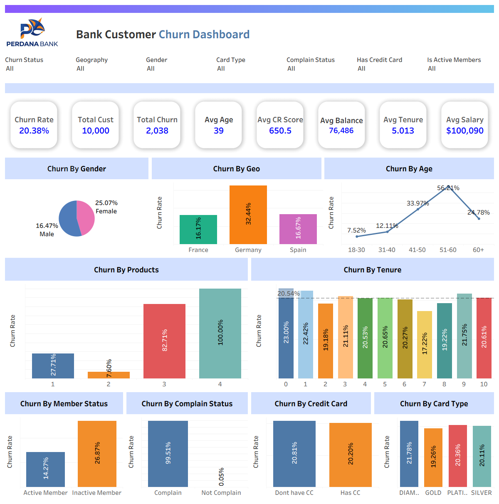

# bank-customer-churn
Churn analysis of a retail bank's 10,000 customers: 20 business questions answered Tableau dashboard design, and prioritised retention recommendations.

**Tools:**  Tableau

---

## 1. Dashboard

 

## 2. Project summary

| | |
|---|---|
| Customers | 10,000  |
| Churned | 2,038 (20.4%) |
| Balance held by churned customers | 185.7M (24.3% of total balances; currency not specified in the data) |
| Biggest drivers | Age 40+, inactivity, Germany, product count (3 & 4), gender |
| Segment to target | Inactive customers, aged 40+ |

###  Findings
1. **Germany churns at 32.4%, double France (16.2%) and Spain (16.7%).** It holds 25% of customers but 40% of churners and **53% of the balance lost**.
2. **Age is the strongest demographic driver.** Churn rises from 7.5% (18-30) to 34.0% (41-50) and 56.2% (51-60).
3. **Inactivity nearly doubles churn** (26.9% vs 14.3%), and it compounds with age: inactive customers aged 51-60 churn at 85.7%.
4. **The higher the product, more likely to churn.** One product: 27.7%. Three products: 82.7%. Four products: 100% (60 of 60).
5. **Women churn more than men** (25.1% vs 16.5%), in every country.
6. **Things that do not matter much:** tenure, credit score, salary, card type, having a credit card are all roughly flat.

---

## 3. Dataset

`Customer-Churn-Records.csv`: 10,000 rows, 18 columns. From public Kaggle bank-churn dataset.

## 4. 20 business questions and answers

### A. Overall picture
**Q1. What is the overall churn rate?**
20.4% (2,038 of 10,000). Roughly 1 in 5 customers has left.

**Q2. How much money is walking out the door?**
Churned customers held 185.7M in balances, 24.3% of all balances. Their average balance (91.1K) is **25% higher** than retained customers' (72.7K), so the bank is losing higher than average customers. 

### B. Who churns (demographics)
**Q3. Which country has the biggest problem?**
Germany: 32.4% vs France 16.2% and Spain 16.7%. Germany is 25% of customers, 39.9% of churners, and 52.8% of lost balance (98.0M of 185.7M).

**Q4. Does gender matter?**
Yes. Female 25.1% vs male 16.5%. The gap holds in every country: France 20.3 vs 12.8, Germany 37.6 vs 27.8, Spain 21.2 vs 13.1.

**Q5. Which age groups churn most?**
| Age band | Customers | Churn |
|---|---|---|
| 18-30 | 1,968 | 7.5% |
| 31-40 | 4,451 | 12.1% |
| 41-50 | 2,320 | 34.0% |
| 51-60 | 797 | **56.2%** |
| 60+ | 464 | 24.8% |

Customers aged 41-60 are 31% of the base but 60.6% of churners.

**Q6. Where do most churners come from, by age?**
41-50 is the largest pool of churners (38.7%), then 31-40 (26.4%), then 51-60 (22.0%). The 51-60 band has the highest rate but a smaller pool, so the 41-50 band is the bigger volume opportunity.

### C. Engagement and products
**Q7. Do inactive members churn more?**
Yes: 26.9% vs 14.3%. Inactive members are 48.5% of customers and 63.9% of churners (1,303 of 2,038).

**Q8. How does product count relate to churn?**
| Products | Customers | Churn |
|---|---|---|
| 1 | 5,084 | 27.7% |
| 2 | 4,590 | **7.6%** |
| 3 | 266 | 82.7% |
| 4 | 60 | 100% |

 1 to 2 products looks protective, but 3+ is a red flag. Only 326 customers hold 3+, yet 280 churned (85.9%).Possibly an aggressive upselling, a product problem, or already-unhappy customers.

**Q9. Does having a credit card matter?**
No. 20.2% (has card) vs 20.8% (no card).

**Q10. Does card tier or points earned matter?**
Barely. Diamond 21.8%, Platinum 20.4%, Silver 20.1%, Gold 19.3%. Average points earned are almost identical for churned (604) and retained (607) customers. The loyalty/points programme is not retaining anyone.

**Q11. Does tenure matter?**
Not meaningfully. Churn sits between 17% and 23% for all tenures, with first-year customers slightly higher (22-23%). Churn is not a "new customer" problem.

### D. Financial profile
**Q12. Do customers with high balances churn more?**
Customers with a balance churn at 24.1% vs 13.8% for zero-balance customers. Churn peaks at 27.0% for balances of 100K-125K. Because zero-balance customers are 36% of the base, the bank's most valuable customers are the ones leaving.

**Q13. Does credit score matter?**
Weakly. Poor (<580): 22.0%; good (670-739): 18.6%; the pattern is not monotonic. Not a useful targeting variable.

**Q14. Does salary matter?**
No. Salary quartiles range 19.8% to 21.6%.

### E. Service and satisfaction
**Q15. Do complaints predict churn?**
Overwhelmingly 99.5% of complainers churned (2,034 of 2,044) vs 0.05% of non-complainers (4 of 7,956)

**Q16. Does satisfaction score predict churn?**
No. Churn is 20.0%, 21.8%, 19.6%, 20.6%, 19.8% across scores 1 to 5. 

### F. Combinations and segments
**Q17. What is the single highest-risk segment?**
Inactive customers aged 40+: **1,880 customers, 49.4% churn, 929 churners = 45.6% of all churners.** Everyone else churns at 13.7%.

**Q18. Which Geography x Age x Activity combinations are worst (n >= 100)?**
| Segment | Customers | Churn |
|---|---|---|
| Germany, 51-60, inactive | 131 | 88.5% |
| France, 51-60, inactive | 142 | 83.8% |
| Germany, 41-50, inactive | 370 | 55.9% |
| Germany, 51-60, active | 112 | 47.3% |
| Germany, 41-50, active | 308 | 40.3% |

Even **active** German customers aged 41+ churn at 40-47%, so Germany has a problem that engagement alone does not fix. Germany aged 40+ overall: 1,140 customers at 50.8%.

---

## 5. Recommendations

| Priority | Action | Why |
|---|---|---|
| 1 | **Re-engagement campaign for inactive customers aged 40+** (personal outreach, relationship manager call, tailored offers) | 1,880 customers, 49.4% churn, 45.6% of all churners |
| 2 | **Germany deep-dive**: investigate pricing, competition, service and branch experience | 32.4% churn, 53% of lost balance; even active German customers aged 41+ churn at 40%+ |
| 3 | **Cross-sell to a second product, but stop at two** for single-product customers; review what happens to customers sold 3+ products | 2 products: 7.6% churn; 3-4 products: 83-100% |
| 4 | **Retention offers for high-balance customers** (100K+) | Churned customers hold 25% more on average; 185.7M at stake |
| 5 | **Complaint handling and early-warning**: fix resolution process, and review why satisfaction scores do not track churn | 99.5% of complainers leave |
| 6 | **Women-focused research** (survey or interviews) | 8.6-point gap that holds in every country |

cutting churn in the 40+ inactive segment from 49.4% to 40% would retain roughly 177 customers (1,880 x 9.4%), and about 1 point of overall churn per 100 customers retained.

---

## 6. Data quality and caveats

- **Small samples:** 3+ product customers (n=326) and some segment cells are small; counts are shown in the dashboard tooltips.
- **Static snapshot:** no dates, so churn timing, cohorts and trends over time cannot be analysed.
- **Currency** is not specified; balances are shown as plain numbers.

---

